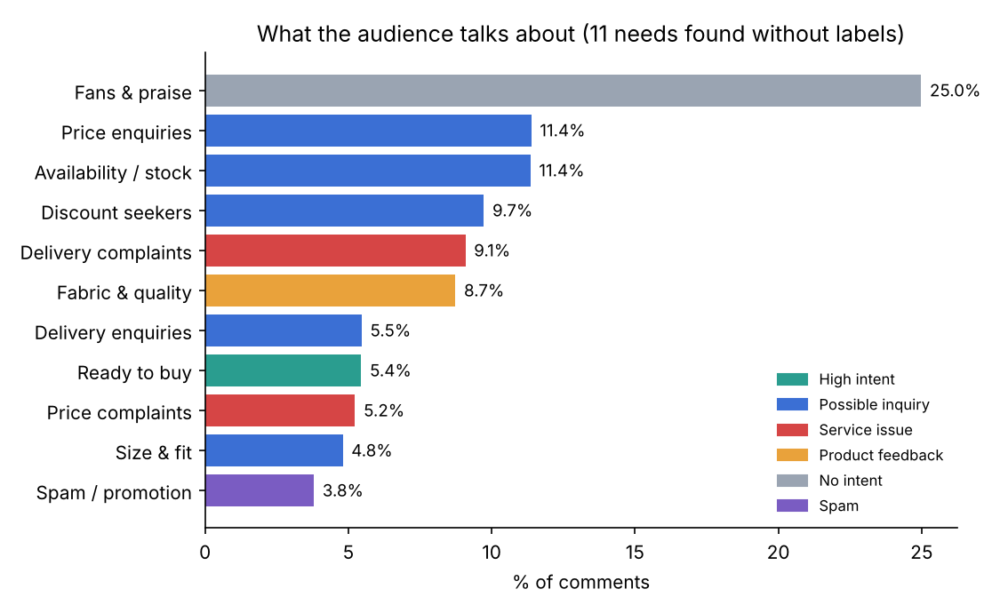
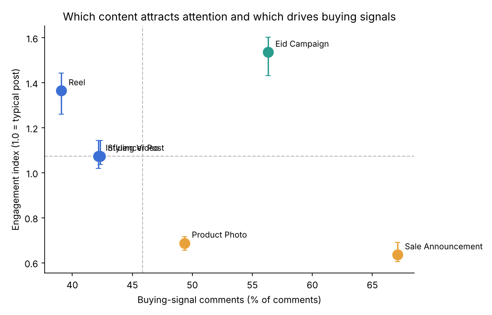
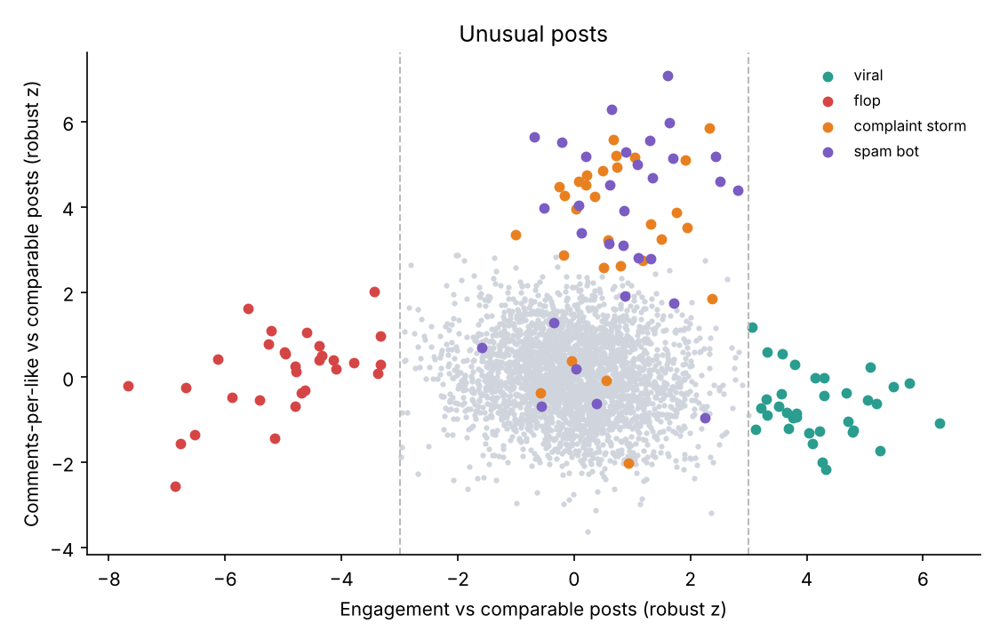
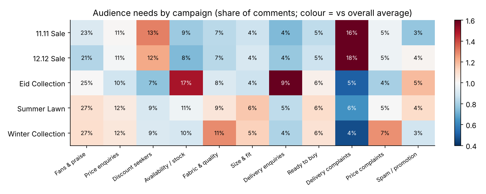

# Project 3 — Audience Behaviour Discovery Engine

**Problem:** a Lahore-based online brand runs Instagram, TikTok and Facebook campaigns for its 11.11 / 12.12 / Eid lawn collections and receives thousands of comments like *"Price please?"*, *"Delivery kitne din mein hogi?"*, *"Ordered last week, still waiting."* It does not know which audience needs and content patterns are hidden inside them.

**What was built:** an engine that groups similar audience behaviour, flags unusual posts, and turns the findings into marketing actions, plus a small web app (`app/app.py`, or the single-file `dashboard.html`) that answers the five questions of the brief.

> **Data note.** All posts and comments are **simulated** (Brand A–E are fictional). The brief asks to separate real observations from generated ones and to respect platform terms, so every row carries `data_source = simulated`, and the hidden "truth" used only for validation is kept in a separate file. See Section 6 for how to run the engine on real data.

---

## 1. Results at a glance

| Question | Finding |
|---|---|
| Which content attracts attention? | **Eid Campaign posts** (engagement index 1.54) and **Reels** (1.36) lead. **Sale Announcements** (0.64) and **Product Photos** (0.69) attract the least attention but have the most buying signals (67% and 49% of comments). |
| What does the audience want? | 11 needs found without labels. Largest: fans and praise (25%), price enquiries (11%), availability (11%), discount seekers (10%), delivery complaints (9%). |
| Which patterns are unusual? | 124 posts flagged: 34 viral, 30 flops, 29 complaint storms, 31 spam-flooded. |
| Which needs should the brand address? | Delivery complaints spike in 11.11 / 12.12 sale campaigns (16–18% of comments vs 9% overall) and at Brand C (15%). Brand D has an availability gap (18% vs about 10%). Eid campaigns draw availability and delivery questions. |
| What to do next? | 15 evidence-backed actions; top three: fix late deliveries and reply on complaint-storm posts, put offers up front for discount seekers, lead Instagram with Eid campaign content while keeping Sale Announcements as converters. |

How well does it work? Against the simulator's hidden truth: audience groups match the true topics with **ARI 0.91 / NMI 0.90 / purity 0.93**, and unusual-post detection reaches **precision 0.86 / recall 0.90** (Section 5).



## 2. Data (Tables A and B of the brief)

| File | Rows | Contents |
|---|---|---|
| `data/posts.csv` | 3,000 | Table A: `post_id, brand, platform, campaign, content_type, product_category, likes, comments_count, shares, views, days_since_post` plus `post_date, collection_date, data_source` |
| `data/comments.csv` | 22,669 | Table B: `post_id, comment_text, language_type, topic, sentiment, purchase_intent` plus `comment_id, data_source` |
| `data/posts_truth.csv` | 3,000 | Hidden planted-anomaly labels, used only for validation |

* One product category (women's lawn suits), five brands, three platforms, five campaigns (Eid Collection, 11.11 Sale, 12.12 Sale, Summer Lawn, Winter Collection) and the six content types of the brief.
* `views` is missing for about 30% of posts and `shares` for about 14% (as on real platforms); the engine does not require them.
* Comments are English (39%), Roman Urdu (47%, with spelling variants such as *kitne / kitney / kitny*) and Urdu script (15%), with emojis and typos. The comments table is a **sample** of each post's comments (3–15), not all of them.
* Planted patterns the engine must rediscover: content types behave differently; sale campaigns raise discount and late-delivery comments; Brand C has a delivery problem, Brand D stock gaps, Brand E price pushback; about 4% of posts are viral, flop, complaint-storm or spam-flood.
* The three real sources named in the brief (the 2026 Pakistani fashion-brand sentiment dataset, the Open Data Pakistan e-commerce orders and the Hugging Face fashion catalogue) were **not used**: their availability and reuse permissions need checking first, and the e-commerce and catalogue data are not social comments.

## 3. Method

**Q2 — Audience needs (`AudienceModel` in `src/engine.py`).** Unsupervised and multilingual:
1. Clean text (strip emojis, collapse repeated letters, normalise Roman Urdu spellings; Urdu script kept).
2. Features = character n-gram + word TF-IDF reduced with SVD, **plus** a small multilingual need lexicon (price, fabric, size, delivery, discount, availability, buying intent, praise, spam) and a "complaint tone" signal. The lexicon is what lets *"Price bataein?"*, *"Price please?"* and *"قیمت کیا ہے؟"* land in the same group.
3. K-Means (k chosen from 8–16 by silhouette → 15 clusters). Clusters are named from their member comments and distinctive words, and clusters sharing a need are merged into **11 needs**. Each need is mapped to an intent tier (High intent, Possible inquiry, Service issue, Product feedback, No intent, Spam).
4. New comments can be classified live (`/api/classify`), for example *"Mera parcel kahan hai? Koi reply nahi"* → Delivery complaints.

The model never reads the `topic`, `sentiment` or `purchase_intent` columns.

**Q1 — Content performance.** Engagement score = likes + 2×comments + 3×shares, divided by the median for that brand and platform, giving an **engagement index** (1.00 = typical). Only posts at least 7 days old are compared, with bootstrap 90% intervals. Each format is also scored on share-to-like ratio, comments per 1,000 likes and its share of buying-signal comments, then given a role: *Star*, *Awareness only*, *Hidden converter* or *Rethink*.



| Content type | Posts | Engagement index (90% CI) | Buying-signal comments | Role |
|---|---|---|---|---|
| Eid Campaign | 229 | 1.54 (1.43–1.60) | 56% | Star |
| Reel | 750 | 1.36 (1.26–1.44) | 39% | Awareness only |
| Influencer Post | 486 | 1.07 (1.02–1.14) | 42% | Awareness only |
| Styling Video | 423 | 1.07 (1.04–1.14) | 42% | Awareness only |
| Product Photo | 435 | 0.69 (0.66–0.72) | 49% | Hidden converter |
| Sale Announcement | 486 | 0.64 (0.60–0.69) | 67% | Hidden converter |

Other differences: Styling Videos are shared most (0.22 shares per like), and Sale Announcements start the most conversation (399 comments per 1,000 likes).

**Q3 — Unusual patterns.** A robust regression predicts what each post should get given its brand, platform, format, campaign and age; the residual is scaled by the median absolute deviation. Posts with |z| ≥ 3 on engagement (viral / flop), or an unusually high comments-per-like ratio, are flagged. A separate test compares each post's complaint and spam share of comments with what comparable posts normally have, adjusted for the number of comments sampled, which avoids flagging late sale posts that naturally attract complaints. Every flag comes with a plain-language reason.



**Q4 — Needs by campaign, brand and platform.** Share of comments per need with lift against the overall average:



* **11.11 / 12.12:** delivery complaints 16% / 18% (about 1.8–2.0× average), discount requests 13% / 12%.
* **Eid:** availability questions 17% and delivery enquiries 9% (are we in stock, will it arrive before Eid).
* **Winter:** fabric/quality 11% and price complaints 7%.
* **Brand C:** delivery complaints 15% (others 7–9%). **Brand D:** availability 18% (others about 10%). **Brand E:** price complaints 8%.
* **Facebook:** price complaints 8% and delivery complaints 11%; **TikTok:** most praise (31%) but most spam (5%).
* Cities named in availability and delivery comments: Karachi 21%, Lahore 20%, Islamabad 13%.

**Q5 — Recommendations.** Rule-based and evidence-driven: each action is generated only when the numbers justify it, shows the evidence that triggered it, the action, and the metric to track, and is ranked by how many customers it affects and how serious it is. Rules cover content, promotions, customer service, stock, spam moderation and A/B tests (with the sample size needed to detect a 25% lift).

Top actions:
1. **High · Customer service:** fix late-delivery complaints. 9% of comments; hot spots 11.11, 12.12 and Brand C; 29 complaint-storm posts to reply to within 2 hours.
2. **High · Promotions:** answer discount requests before they are asked (10% of comments, 42% of them on Sale Announcements): put the offer in the caption and pinned comment.
3. **High · Content:** on Instagram lead with Eid Campaign posts, but keep Product Photos and Sale Announcements as conversion formats.
4. **Medium · Stock:** show availability by city; Karachi, Lahore and Islamabad are named most, and Brand D is above average.
5. **Medium · Content:** Product Photos and Sale Announcements convert better than they attract: support them with paid reach.

## 4. The web app

```bash
pip install -r requirements.txt
python app/app.py          # http://127.0.0.1:5000
```
One page with five sections matching the five questions, filters for brand, platform and campaign (every table recomputes), a **Try a comment** box and a *How reliable is this?* panel. `dashboard.html` is the same page as a single static file that opens without a server.

## 5. Validation (simulated data only)

| Check | Result |
|---|---|
| Audience groups vs true comment topics | ARI **0.912**, NMI **0.904**, purity **0.932** |
| Purity by language | English 0.92, Roman Urdu 0.94, Urdu 0.94 |
| "Ready to buy" detection | precision 0.96, recall 0.87 |
| Unusual posts (all types) | precision **0.86**, recall **0.90** |
| Viral / Flop (planted 39 / 30) | recall 0.77 / 0.90; precision 0.88 / 0.90 |
| Complaint storm / Spam flood (planted 25 / 25) | recall 1.00 / 1.00; precision 0.86 / 0.81 |

**Please read these scores with care.** I developed the engine against this same simulated data and looked at the hidden labels while doing so: the first version scored ARI 0.56, and it reached 0.91 after I added the complaint-tone feature and fixed overlaps in the lexicon; I also tightened the complaint-storm rule after it flagged 76 normal posts. The scores are therefore **optimistic**; on real comments they will be lower. The silhouette score also did not clearly favour one number of clusters (0.19–0.23 for k = 8–16), which is why the lexicon features and the merge-by-need step matter.

## 6. Using real data

Replace `data/posts.csv` and `data/comments.csv` with exports that have the same columns (the `topic`, `sentiment` and `purchase_intent` columns are optional; delete `posts_truth.csv`), then run `python src/build_results.py`. Validation is skipped automatically when no labels exist. Before using real social data, follow each platform's terms, check what is publicly downloadable, and keep the source URL, collection date and reuse permissions for each record.

## 7. Limitations

* **Simulated data:** the patterns found are those built into the simulator; real comments are messier, with more slang, mixed-script words and sarcasm.
* **Handcrafted lexicon:** the Roman Urdu, English and Urdu word lists were written for this domain (lawn suits) and would need extending for other products.
* **Sampled comments:** per-post comment mixes rest on 3–15 comments, so single-post conclusions are noisy; the anomaly rules use sample-size-adjusted tests for this reason.
* **Engagement index** weights (1 : 2 : 3 for likes, comments, shares) are a judgement call; views and shares are often not public.
* **Association, not causation:** "lead with Reels" means Reels get more engagement, not that switching formats will cause it; the A/B-test recommendation exists to check this.
* **Intent from text only:** buying signals are inferred from comments, not from actual orders; linking to the order data would be the next step.

## 8. Files

```
src/simulate_data.py   simulated posts + comments + hidden truth
src/engine.py          AudienceModel (clustering), content performance, anomalies, need mix, recommendations
src/build_results.py   fit, analyse, validate, save results/ and data/ artefacts
src/export_static.py   dashboard.html (no server)
src/charts.py          report figures
app/app.py             Flask web app (+ app/templates/dashboard.html)
results/               audience_needs, content_performance, content_by_platform, unusual_posts, need_mix_by_*, city_demand, recommendations.json, validation.json
charts/                figures used above
dashboard.html         static copy of the app
run_all.sh             one-command rebuild (about 1 minute)
```
